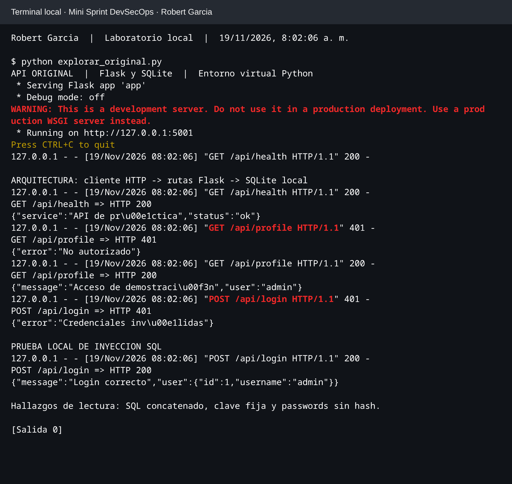

# Exploración de la API original

La versión original se conserva en el commit 5a8922f. Se ejecutó con Python 3.12, Flask y SQLite en un entorno virtual, escuchando sólo en 127.0.0.1:5001 para esta comprobación. Se usaron datos ficticios.

Arquitectura: cliente HTTP → rutas de app.py en Flask → SQLite local.

- GET /api/health devuelve el estado del servicio.
- POST /api/login recibe usuario y contraseña.
- GET /api/profile comprueba X-API-Key.

La lectura de app.py mostró una clave fija, contraseñas sin hash y SQL concatenado. requirements.txt contenía dependencias antiguas. Las peticiones reales confirmaron 200 para salud, 401 para perfil sin clave y 200 con la clave de laboratorio. Un login incorrecto recibió 401, pero el intento de inyección SQL obtuvo 200 en la versión original.

